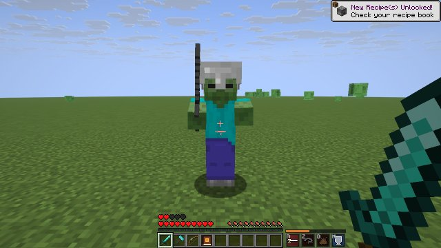
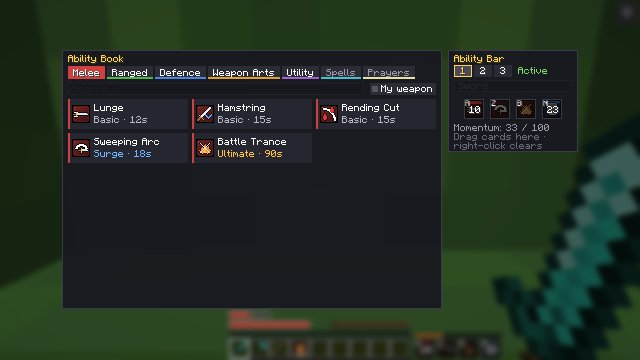
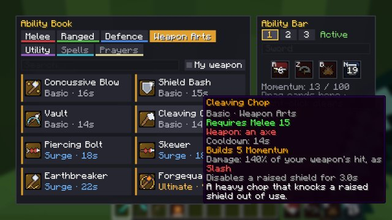

# Combat Abilities: Design Spec

Status: **built** (Phase 6, branch `phase-6-abilities`; see §8 for what was built and every decision made). Owner: Todd. This is the feature spec; `docs/HANDOFF_ABILITIES.md` is the build brief for the implementing session.

## 1. Pitch
A small **ability bar** (4 slots) turns SkillCraft combat from "click until it dies" into a few meaningful decisions per fight:
- **What you bring:** you pick 4 abilities from everything you've unlocked.
- **When you press them:** they have cooldowns and a shared resource.
- **What you hold:** weapon-specific abilities only work with that weapon class.

It builds on what Phase 5 already gives us:
- the stab, slash and crush types plus light, medium and heavy ammo, with monster weaknesses
- typed armour and attack styles
- the Sundered debuff
- boss windows like Slagheart's Vent

Abilities should make those systems *matter more*, not replace them.

### Inspirations (mechanics only; no names, art or text copied)
| Game | What we borrow |
|---|---|
| **RS3** | A resource built by landing hits that gates stronger abilities (basic → threshold → ultimate); defensive abilities as real choices (damage reduction, freedom from stuns, reflect); an ability book. |
| **RuneScape: Dragonwilds** | Weapon-class specials, so weapons feel different; **parry into a counterattack** as a skill-expression defensive; resource costs eased slightly by combat level. |
| **OSRS** | Weapon **special attacks** on a separate energy pool; **prayers** as toggles that drain a resource (future); readable boss mechanics where the right button at the right time matters. |
| **Guild Wars 2 / Albion** | Weapon class decides part of your kit, which encourages carrying and swapping weapons. |
| **WoW / FFXIV** | A short global cooldown, clear cooldown sweeps on the HUD, and saved loadouts. |

### Design pillars
1. **Few buttons, big decisions.** 4 slots, a tunable constant (try 4, maybe 5 later). No ability spam: there's a short global cooldown and real cooldowns.
2. **Horizontal, not vertical.** New abilities add *options* (crowd control, mobility, defence, burst for a specific damage type), not flat DPS creep. A level-40 player has more *choices*, not 3× the damage.
3. **Weapons matter.** Weapon Arts only work with their weapon class, so warhammer and spear players fight differently.
4. **Minecraft-readable.** Every ability has a clear tell (sound, particles, arm swing or short windup) and works with Minecraft's real-time, no-miss combat.
5. **Server-authoritative and data-driven.** The client only asks; the server validates and runs everything. Numbers live in JSON so Todd can tune them with `/reload`.
6. **Built for later.** The same framework must later support **Spells** (Magic skill, rune costs) and **Prayers** (toggles draining prayer points) without a rewrite.

## 2. Core concepts
### 2.1 The bar
- **4 slots**, shown on the HUD to the right of the vanilla hotbar.
- Each slot shows an icon, its keybind, a cooldown sweep and a "not usable now" dim (wrong weapon, not enough Momentum).
- **Default keys: R, G, Z, X**, all rebindable under "SkillCraft – Abilities". *The implementer must confirm these don't clash with 26.2 vanilla defaults, and pick different defaults if they do.*
- **Loadouts:** 3 saved bars per player. Switch with the Ability Book or a keybind, but **not in combat** (in combat = dealt or took entity damage in the last 5 s).
- *Option to test in playtesting:* a dedicated 5th **Weapon Art slot** that automatically shows the held weapon's art (GW2-style). It's off by default, behind a config flag.

### 2.2 Momentum (the shared resource)
An original name for the RS3-adrenaline-style resource. It runs from 0 to 100 and is shown as a thin bar above the ability slots.
- **Gain:**
  - +6 per fully-charged melee hit that lands (scaled by attack strength; weak spam hits give little)
  - +5 per projectile hit
  - +2 per hit taken (so tanks build some)
- **Decay:** after 10 s out of combat, it drains 5 per second.
- **Ability classes:**
  - **Basic:** free, cooldown only. Many *generate* +5 to +10 Momentum.
  - **Surge:** needs ≥ 50 and spends 25.
  - **Ultimate:** needs 100 and spends all of it. These have long cooldowns.
- **Combat level eases costs:** −1% Momentum cost per 10 levels in the relevant skill (a Dragonwilds-style nod).

### 2.3 Cooldowns and timing
- **Global cooldown (GCD):** 1.0 s after any ability. Pure defensives are exempt (they're "off-GCD"), so you can always react.
- **Per-ability cooldowns** of 8–120 s, shown as a sweep.
- **Windups:** some abilities have a short windup (0.25–0.6 s). Moving cancels it with no cooldown spent (state per ability).
- Cooldowns and Momentum **aren't saved** across logout. They reset, which is harmless and simpler.

### 2.4 Requirements and unlocking
- **By level:** each ability needs a level in Melee, Ranged, Defence or Constitution (later also Magic and Prayer). Vanilla-tier abilities unlock at **1–50**, matching our tier rules. 51–99 is reserved for custom-tier abilities.
- **By weapon:** Weapon Arts also need a weapon class held (a data item tag, e.g. `#skillcraft:weapon_class/warhammer`).
- **By Codex:** a few abilities unlock from a **Codex** item, read once to learn permanently, dropped by bosses or found in the world. That makes bosses worth farming for more than resources.
  - Example: **Slagheart** drops *Codex of the Forgequake*, about 1/60 per eligible kill.
  - Learned codices are saved on the player.
- **Level-up toast:** "New ability unlocked: Riposte (Defence 10). Open your Ability Book (J) to add it to your bar."

### 2.5 Ability Book screen (key **J**)
- **Tabs:** Melee, Ranged, Defence, Weapon Arts, Utility. *Spells* and *Prayers* tabs are shown locked: "Coming with the Magic / Prayer skills".
- **Cards** show the icon, name, class (Basic / Surge / Ultimate), requirement, cooldown, Momentum cost and weapon requirement, plus a one-line description. A tooltip gives the full numbers.
- Locked cards show what unlocks them (level, weapon or Codex).
- **Drag a card onto a bar slot** (or click a slot, then a card). Right-click a slot to clear it.
- **Loadout selector** for 3 bars, with optional names.
- **Search** by name, and a **"Usable with my weapon"** filter.
- **Responsive layout:** follow the bank screen's approach of side-by-side or stacked panels that fit every GUI scale.

### 2.6 Crowd control, and bosses
Normal mobs take stuns, roots and slows fully. **Bosses don't** (Slagheart and later bosses):
- **Stun / interrupt** → **Daze** on a boss: it adds 1 s to its *next* attack cooldown. At most once per 20 s per boss (diminishing returns). It **never cancels a windup that has already started**, so abilities can't trivialise telegraphs.
- **Root / slow** → slows bosses by 30% at most, for half the duration.
- **Knockback** → none on bosses.
- **Damage abilities** go through the normal Phase 5 damage pipeline (`CombatDamage`), so type matchups, Sundered, styles and combat XP all apply automatically. **Abilities never grant XP on their own.**
- **Boss windows are the place to burst:** e.g. Slagheart's **Vent** (stab ×1.5) pairs naturally with stab Weapon Arts and Surge abilities. Mention this in the boss doc.

### 2.7 PvP
PvP is **off by default** (config `abilitiesAffectPlayers=false`). When it's on, ability damage and crowd control on players are halved, and roots and stuns last at most 1 s.

## 3. The starter catalogue (vanilla tiers, levels 1–50)
Damage is given as **% of the held weapon's normal hit** (RS3-style), so abilities scale with gear and stay horizontal. "Momentum +x" means the ability *generates* Momentum. All numbers are starting points for playtesting.

### Melee (Melee level)
| Ability | Lvl | Class | Weapon | Effect | CD |
|---|---|---|---|---|---|
| **Lunge** | 1 | Basic | any melee | Dash 3 blocks forward and strike the first enemy for 110%. Momentum +8. | 12 s |
| **Hamstring** | 8 | Basic | any melee | 90% hit that slows the target 40% for 4 s. | 15 s |
| **Rending Cut** | 12 | Basic | slash | 80% hit plus **Bleed**: 60% more over 4 s (bosses take it too). | 15 s |
| **Sweeping Arc** | 18 | Surge | slash | 150° cleave in 3.5 blocks, 120% to each target. | 18 s |
| **Battle Trance** | 35 | Ultimate | any melee | 10 s: +25% melee damage, but you take +10% damage. | 90 s |

### Ranged (Ranged level)
| Ability | Lvl | Class | Weapon | Effect | CD |
|---|---|---|---|---|---|
| **Quick Draw** | 1 | Basic | bow / crossbow | Your next shot within 3 s is fully charged instantly. Momentum +6. | 10 s |
| **Pinning Shot** | 10 | Basic | any ranged | The next arrow roots its target for 2 s (bosses: 30% slow). | 18 s |
| **Tumble** | 15 | Basic | any ranged | Leap 4 blocks backwards; the next shot deals +20%. Off-GCD. | 14 s |
| **Volley** | 22 | Surge | bow | Fire 5 arrows in a fan, each 70%. Uses up to 3 arrows. | 20 s |
| **Deadeye** | 40 | Ultimate | any ranged | 8 s: arrows fly straight (no drop), +30% damage, and heavy ammo pierces 1 extra target. | 100 s |

### Defence (Defence level; Constitution where noted)
| Ability | Lvl | Class | Effect | CD |
|---|---|---|---|---|
| **Brace** | 1 | Basic, off-GCD | 3 s: −40% damage taken, and you can't sprint. | 25 s |
| **Riposte** | 10 | Basic, off-GCD | 0.6 s parry window. If an entity's melee or projectile hits you in it, the damage is negated and your next melee hit within 2 s deals +100% and Momentum +15. The window is visible as a shield flash. *(Dragonwilds parry-counter nod.)* | 12 s |
| **Unshackle** | 15 | Basic, off-GCD | Removes slows, roots and stuns, and grants 3 s immunity to them. | 30 s |
| **Second Wind** | Constitution 20 | Basic | Heals 30% of max health over 5 s. | 60 s |
| **Bulwark** | 25 | Surge | 6 s: +4 armour, and 20% of melee damage taken is reflected. | 40 s |
| **Last Stand** | 40 | Ultimate, off-GCD | 6 s: no single hit can deal more than 20% of your max health, and you can't be knocked back. | 120 s |

### Weapon Arts (need the weapon class held; the level is in the weapon's skill)
| Ability | Lvl | Weapon class | Class | Effect | CD |
|---|---|---|---|---|---|
| **Concussive Blow** | Melee 10 | warhammer / mace | Basic | 130% crush hit; stuns mobs for 1.5 s (bosses: Daze). | 16 s |
| **Earthbreaker** | Melee 25 | warhammer / mace / maul | Surge | Ground slam, radius 3: 140% crush and slows by 30% for 3 s. | 22 s |
| **Vault** | Melee 12 | spear | Basic | Pole-vault 5 blocks in the facing direction (a movement tool for boss rings). Off-GCD. | 14 s |
| **Skewer** | Melee 20 | spear / trident (melee) | Surge | Line thrust 5 blocks long, 130% stab to every enemy in the line. | 18 s |
| **Cleaving Chop** | Melee 15 | axe | Basic | 140% slash; it disables a shield-raising target for 3 s (players / blocking mobs). | 14 s |
| **Shield Bash** | Defence 10 | shield in offhand | Basic | 70% crush hit, interrupts mobs (bosses: Daze), and knockback. | 15 s |
| **Twinfang** | Melee 20 | melee weapon + sword or axe in offhand | Basic | 100% of the **off-hand** blade's hit, as that blade's damage type. Added in the build (§8.7). | 10 s |
| **Torchbrand** | Melee 5 | torch in offhand | Basic | 60% hit that sets the target on fire for 5 s. Added in the build (§8.7). | 12 s |
| **Piercing Bolt** | Ranged 20 | crossbow | Surge | The next bolt pierces up to 4 targets at 120%. | 18 s |
| **Undertow** | Ranged 30 | trident (thrown) | Basic | The thrown trident returns and **pulls** the target 3 blocks towards you (mobs only). | 16 s |
| **Forgequake** | Codex (Slagheart) + Melee 35 | **Emberfall Maul only** | Ultimate | Slam, radius 4: 200% crush and applies **Sundered** to everything hit. | 90 s |

### Utility
| Ability | Req | Class | Effect | CD |
|---|---|---|---|---|
| **Sprint Burst** | Constitution 10 | Basic, off-GCD | 4 s of +30% movement speed. (Moves to Agility when that skill arrives.) | 30 s |

Total: **26 abilities.** The first build should deliver **at least 14**: Lunge, Hamstring, Rending Cut, Sweeping Arc, Battle Trance, Quick Draw, Pinning Shot, Tumble, Volley, Brace, Riposte, Unshackle, Second Wind, plus at least 3 Weapon Arts including **Concussive Blow**, **Vault** and **Forgequake**. The rest can follow in v2. The spec stays the source of truth for later ones.

### Future (framework must allow it; don't build it now)
- **Spells (Magic skill):** an ability type that consumes *items* (runes) instead of or as well as Momentum, e.g. *Ember Bolt*, *Bind*, *Teleport home*. Magic is already reserved in `DamageStyle`.
- **Prayers (Prayer skill):** **toggle** abilities with a **drain** resource (prayer points), e.g. protect-from-melee/ranged (−40% from that group), and +5% damage buffs. They occupy bar slots *or* a separate prayer panel; decide when Prayer is designed.
- **Custom-tier abilities (51–99)** arriving with custom weapon tiers.

## 4. Data model (suggested; the implementer may refine it)
- **Datapack registry `skillcraft:ability`** (NeoForge datapack registry, synced to clients). One JSON per ability, e.g. `data/skillcraft/skillcraft/ability/lunge.json`:
```json
{
  "category": "melee",
  "class": "basic",
  "requires": { "skill": "melee", "level": 1, "weapon_tag": "skillcraft:weapon_class/melee", "codex": null },
  "cooldown": 240,
  "momentum": { "generate": 8 },
  "off_gcd": false,
  "windup": 0,
  "behavior": { "type": "skillcraft:dash_strike", "distance": 3.0, "damage": 1.1 },
  "icon": "skillcraft:ability/lunge"
}
```
- **Behaviours are Java code**, picked by `behavior.type` (dispatch codec): `dash_strike`, `melee_strike` (with optional effect), `cleave`, `ground_slam`, `line_thrust`, `next_shot_modifier`, `volley`, `leap`, `buff`, `heal_over_time`, `parry`, `cleanse`, `pull`… Each new ability should mostly be **JSON reusing a behaviour**.
- **Weapon classes as item tags:** `#skillcraft:weapon_class/{sword,axe,spear,trident,warhammer,mace,maul,bow,crossbow,shield,melee,ranged}`.
- **Player attachment `abilities`** (saved, copyOnDeath, synced to the owner): `learned` (codex ids), `loadouts` (3 × 4 ability ids), `activeLoadout`, `momentum` (synced, not saved).
- **Cooldowns:** a server-side map, plus an S2C sync payload on use (`slot`, `readyAtTick`) for the HUD sweep.
- **Network:** `UseAbilityPayload(slot)` C2S; `SetLoadoutPayload(loadout, slots[])` C2S (validated: unlocked, not in combat); `AbilityCooldownPayload` S2C. Momentum syncs through the attachment.
- **Effects:** new `MobEffect`s for Bleed, Rooted, Dazed (boss variant), Battle Trance, Bulwark, Last Stand and Riposte-ready. These get vanilla effect icons in the inventory.
- **Codex item:** `skillcraft:codex` with a component naming the ability id. Right-click to learn it. Added to Slagheart's loot table.

## 5. Feel and readability checklist
- Every ability has a **sound** (new sound events, vanilla audio for now) and **particles** at the caster and on hit. Show cooldown-ready "pings" only for Ultimates.
- **Arm swing** or a use animation where possible. A custom player animation library is out of scope unless one exists for 26.2 and is lightweight.
- A "no" sound and a short reason on the overlay when an ability can't be used (cooldown, Momentum, weapon, in-combat swap…), throttled.
- The HUD bar must stay readable at every GUI scale and not overlap the vanilla hotbar, offhand slot, attack indicator or our XP drops.

## 6. Balance guardrails
- **Sustained DPS gain** from a well-played bar vs. auto-attacking only: **+15–25%** at equal gear. Burst windows (an Ultimate during a boss vent) may spike higher.
- **Slagheart kill time** for a level-30 to 40 player should drop by roughly 15–20%, not halve.
- **Defensives** should let a player survive *one* mistake, not ignore mechanics. Last Stand can't make you immune to Slagheart's ring mechanics; it caps damage per hit.
- **Mobility** (Lunge, Vault, Tumble) mustn't skip arena boundaries or pass through walls. Raycast against blocks and stop at the first obstruction.
- **Verify with numbers:** a GameTest or harness that simulates 60 s against a dummy with and without a scripted rotation, and reports the DPS ratio.

## 7. Open questions for Todd (the implementer should choose defaults and note them)
1. Should the 5th "Weapon Art" auto-slot exist (off by default)?
2. Should loadout swaps stay blocked during combat, or only during boss fights?
3. Momentum gain values, and whether hits *taken* should build it.
4. Should Codex drops be bound to the player (not tradeable), or tradeable? *Default: tradeable* (good for the server economy).
5. Default keys R / G / Z / X, or Alt + 1–4?

## 8. As built (Phase 6): decisions and deviations
This section records what the first build does wherever the spec left a choice or had to change. The code is in `ability/` (server), `client/ability/` (HUD, Ability Book, keys) and `gametest/AbilityTests`.

### 8.1 Answers to §7
1. **5th Weapon Art auto-slot:** **not built.**
   - Weapon Arts sit in the normal 4 slots, and the HUD dims a slot when the held weapon doesn't fit.
   - The bar size is one constant (`AbilityData.SLOTS`), so a 5th slot is a small change if playtesting asks for it.
2. **Loadout swaps:** **blocked in any combat**, meaning you dealt or took entity damage in the last 5 s (`combatWindow` in the server config).
   - What's blocked: switching bars, and editing the bar you're using.
   - Editing one of your other bars is always allowed, so you can prepare.
3. **Momentum values:** as proposed, and **hits taken do build Momentum**:
   - +6 per melee hit, scaled by attack strength squared, so a half-charged swing gives 1.5
   - +5 per projectile hit
   - +2 per hit taken, at most twice a second, so a mob swarm can't fill the bar
   - Decay: 5 per second after 10 s out of combat
   - All of these are server-config values, so they can be tuned without code changes.
4. **Codex drops:** **tradeable**. One `skillcraft:codex` item with a `skillcraft:codex_ability` component.
5. **Default keys:** **R, Z, B, N.**
   - The proposed R/G/Z/X clashes with 26.2's own defaults: G is Quick Actions and X is Load Toolbar. These were checked against the decompiled 26.2 `Options`.
   - Alt+1–4 wasn't used because the number keys already select hotbar slots.
   - **J** opens the Ability Book. "Next ability bar" has no default key.
   - Everything is rebindable under "SkillCraft – Abilities".

### 8.2 Data model
- **Abilities load from JSON at the spec's path** (`data/<ns>/skillcraft/ability/<id>.json`), but through a reload listener (`AbilityManager`) rather than a NeoForge datapack registry.
  - Datapack registries only reload when a world loads. A listener lets `/reload` retune abilities live, which was a non-negotiable.
  - Definitions are sent to clients on login and after every `/reload`.
- **Behaviours** are a dispatch codec (`AbilityBehaviors`).
  - Types: `melee_strike`, `dash_strike`, `cleave`, `ground_slam`, `line_thrust`, `leap`, `next_shot`, `volley`, `buff`, `heal_over_time`, `parry`, `cleanse`, `toggle_effect`.
  - New abilities are mostly JSON reusing these.
- **Requirements** extend the spec's `weapon_tag`:
  - `weapon`: an item tag for the main hand
  - `weapon_style`: a damage type of the main-hand weapon, read from the existing `weapon_styles` data map, so "slash" means swords and axes without a second list to maintain
  - `offhand`: an item tag for the off hand, e.g. a shield for Shield Bash. It can be combined with `weapon` (§8.7).
  - `codex`: whether a Codex must be read first
- **Weapon classes** are item tags in `skillcraft:weapon_class/`:
  - single weapon types: `sword`, `axe`, `spear`, `trident`, `warhammer`, `mace`, `maul`, `bow`, `crossbow`, `shield`
  - broad groups: `melee`, `ranged`
  - combinations: `hammer` (warhammer or mace), `heavy_blunt` (warhammer, mace or maul), `polearm` (spear or trident)
- **Effect strength is data-driven two ways:**
  - Attribute effects scale with the amplifier the JSON gives:
    - Slowed: −10% speed per level
    - Fleet: +10% speed per level
    - Bulwark: +1 armour per level
  - Event-based effects read `data_maps/mob_effect/effect_tuning.json`:
    - Battle Trance: +25% dealt, +10% taken
    - Brace: −40% taken
    - Bulwark: 20% reflect
    - Last Stand: hits capped at 20% of max health
    - Deadeye: +30% damage, +1 pierce
- **Player data:** `abilities` holds 3 bars of 4 slots, bar names, the active bar, learned codices and Momentum. It's saved and kept through death; Momentum and the combat timer are synced but never saved.
- **Cooldowns:** a separate unsaved `ability_runtime` attachment holds cooldowns and windup and buff states. They reset on logout and on death, as the spec says.
- **Spells and Prayers are ready without a rewrite:**
  - `item_costs` lists items consumed per use (future runes).
  - `toggle` with `drain_per_second` gives a sustained ability that switches off when the resource runs dry (future prayers). It drains Momentum today; Prayer will bring its own resource.
  - The `toggle_effect` behaviour is the stub.
  - The `ability_future` GameTest builds both kinds in code, round-trips them through the JSON codec and runs them.
  - The Spells and Prayers tabs exist but are locked.

### 8.3 Rules the spec left open
- **Global cooldown:** 1 s (`abilityGlobalCooldown`). Off-GCD abilities (Brace, Riposte, Unshackle, Last Stand, Tumble, Vault, Sprint Burst) neither wait for it nor trigger it.
- **Windups:**
  - Sweeping Arc 0.2 s, Volley 0.3 s, Earthbreaker 0.4 s, Forgequake 0.6 s.
  - Moving more than 0.35 blocks cancels a windup with nothing spent. The HUD shows a windup bar.
- **"Needs a target":** damage abilities (strikes, Cleave, slams, thrusts) need at least one enemy in their area. Otherwise they do nothing and cost nothing, so a whiff never wastes a 90 s Ultimate. Movement, buffs and next-shot abilities always fire.
- **"% of the weapon's normal hit"** means the attack-damage attribute: the weapon plus anything else that raises it. Enchantment bonuses (Sharpness) and critical hits aren't included.
- **Ability hits don't leave hit-immunity frames behind**, so an ability never eats your next normal swing. Bleed ticks work the same way.
- **Momentum costs:** the combat-level discount (−1% per 10 levels) applies to both the requirement and the cost. Ultimates still need a "full" bar after the discount (96 at level 40) and spend all of it.
- **Creative players** have every ability unlocked, for testing. Weapon, cooldown and Momentum rules still apply.
- **Quick Draw is bow-only.** 26.2's crossbow charge can't be skipped cleanly; Piercing Bolt is the crossbow's art.
- **Piercing is done by hand.** `AbilityEvents` damages the target and lets the arrow fly on, because `setPierceLevel` is private in 26.2.
- **Sounds:** each behaviour plays a fitting vanilla sound. An ability's JSON `sound` field can point at a custom sound event later, so no new sound events were added.
- **Arm swings:** strikes swing the arm. There's no custom player animation library.

### 8.4 Bosses (§2.6)
- **Boss list:** bosses are the `skillcraft:bosses` entity tag; Slagheart is in it.
- **Stuns become Daze:** `combat/BossCrowdControl.daze` delays the boss's next attack by 1 s, at most once every 20 s per boss.
  - If the boss is mid-attack (in a windup or strike), the delay is added when the attack ends. Its windup is never cancelled.
- **Roots and slows** become Slowed, capped at III (−30%), for half the time.
- **Knockback and pulls** have no effect on bosses.
- **Effects that stick on Slagheart:** Sundered, Slowed (up to III), Dazed and Bleeding. Real roots and stuns never do.
- **Codex of the Forgequake:** Slagheart drops it at 1/60 per eligible kill (measured 1/60.8 over 20,000 rolls). The other loot rates are unchanged.

### 8.5 The first build's catalogue
- **27 abilities** are built: 25 of §3's 26 (everything except **Undertow**) plus the two off-hand arts in §8.7.
  - Undertow is deferred to v2. It needs the thrown trident's return to drive a pull, and the trident's return logic is private.
- **Bars and HUD:** 3 bars per player, the HUD bar and the Ability Book are built as specified.
  - On narrow GUI scales the HUD bar becomes a 2×2 grid, or a row above the hunger and air bars.

**Screenshots** from the CI showcase (`-Pshowcase=abilities`, software rendering, 1280×720, shown here at half size):

| HUD bar (GUI scale 2) | Ability Book (scale 2) | Weapon Arts tab with a tooltip (scale 3) |
|---|---|---|
|  |  |  |

### 8.6 Verified numbers
These come from `./gradlew runGameTestServer` in CI. **All 20 GameTests pass**: 11 from Phase 5 and 9 new ability tests.

- **`ability_dps`** (§6), 60 s on a training dummy (a husk with full knockback resistance), diamond sword, Melee 40, a swing every 13 ticks:
  - Auto-attacks only: **885.8 damage = 14.76 DPS**.
  - Auto-attacks plus a rotation: **1078.3 damage = 17.97 DPS**. The rotation, highest priority first: Battle Trance, then Sweeping Arc, Rending Cut and Lunge. Uses in 60 s: Battle Trance ×1, Sweeping Arc ×4, Rending Cut ×4, Lunge ×5.
  - **Ratio: ×1.217**, inside the +15–25% target.
  - The test fails outside ×1.05–1.40, so balance changes can't drift unnoticed.
  - That works out to roughly **18% shorter Slagheart kills**, within the 15–20% guardrail. Vent bursts can add a little.
- **`ability_pipeline`:** Concussive Blow on a skeleton dealt **15.63**.
  - That's weapon 8.00 × 1.30 × crush matchup 1.4 × level bonus 1.0225 (Melee 10) × Aggressive style 1.05: exactly the Phase 5 formula.
  - It paid **62.5 Melee XP**, i.e. 4 per damage point, nothing extra.
  - The skeleton was stunned.
- **`ability_validation`:**
  - Refusals: locked by level, wrong weapon (including a warhammer for the slash-only Rending Cut), Codex not read, not enough Momentum (Surge 48 at Melee 40 after the discount, Ultimate 100), the ability's own cooldown and the global cooldown.
  - Allowed: off-GCD defensives during the global cooldown.
  - Lunge generated exactly 8 Momentum.
- **`ability_momentum`:**
  - Gains: +6 per full-strength melee hit, +5 per projectile hit, +2 per hit taken, +0 from ability damage.
  - Out of combat it drained 13 → 3 over 45 ticks (5 per second).
- **`ability_boss_daze`:**
  - On Slagheart, a stun becomes Daze: +20 ticks before its next attack, then refused for 400 ticks.
  - A boss mid-Hammerfall keeps its attack, and its cooldown is untouched until the attack ends.
  - A root becomes Slowed III for half the time; a Slowed VI is capped to III for half the time.
  - Ability knockback has no effect.
- **`ability_wall`:** Lunge toward a wall 1.5 blocks away stopped 0.65 blocks short of the wall face.
- **`ability_loadout`:**
  - A locked ability can't be slotted.
  - In combat, editing the active bar or switching bars is refused, while editing a spare bar works.
  - Out of combat, switching works.
- **`ability_future`:**
  - An item-cost ability (a stand-in rune spell) consumed 2 of 3 items.
  - A toggle draining 10 per second ran, switched off on a second press, and switched itself off when Momentum ran dry.
  - Both are built in code and round-trip through the JSON codec.
- **`ability_offhand`:**
  - Twinfang is refused with nothing or a shield in the off hand, and with an off-hand netherite sword at Melee 30 (it needs 40). A refusal deals no damage.
  - With an iron sword in the main hand and a diamond sword in the off hand, Twinfang uses the diamond sword's hit and its slash type. It dealt **7.09** = off-hand hit 7.00 × slash vs. skeleton 0.9 × level bonus 1.0725 (Melee 30) × Aggressive style 1.05.
  - Torchbrand is refused without a torch, and with one it sets a husk on fire.
- **`loot_rates`** (20,000 rolls):
  - Codex of the Forgequake 329 = **1/60.8** (target 1/60)
  - Emberfall Maul 1/114.3
  - Sigil refund 1/19.7
  - **7.80** gathering-minutes per kill, unchanged

### 8.7 Off-hand arts
Todd pointed out after the first build that the off hand can carry an ability too. Here is what's built.

- **Off-hand requirements:** any ability can require an item class in the off hand (`requires.offhand`), on its own or together with a main-hand `weapon`.
  - Shield Bash was the first. Two more were added:
    - **Twinfang** (Melee 20): with a melee weapon in the main hand and a sword or axe in the off hand, you cut with the **off-hand** blade.
      - It uses that blade's own hit (`AbilityDamage.offhandHit`): the attack-damage attribute, minus the main-hand weapon's bonus, plus the off-hand weapon's.
      - It also uses that blade's own damage type. So a dual-wielder can mix types, for example crush from a mace in the main hand and slash from an axe in the off hand.
      - The off-hand weapon's own Melee gate (`skill_requirements`) still applies, so moving a weapon to the off hand doesn't get around its level.
    - **Torchbrand** (Melee 5): with a torch in the off hand, a 60% hit with the main weapon that sets the target on fire for 5 s.
      - Torches are `weapon_class/torch`: torch, soul torch and copper torch.
      - Fire-immune mobs, Slagheart included, only take the hit.
  - Both are Weapon Arts, because they depend on what you hold.
- **Behaviour options:** `melee_strike` gained two JSON options:
  - `off_hand: true`: strike with the off-hand item. It uses that item's hit and damage type, and the off-hand arm swings.
  - `ignite: <ticks>`: set the target on fire.
- **Requirement text:** the Ability Book and the refusal message name both hands, e.g. "a melee weapon, with a sword or axe in your off hand".
- **Not built:** a dedicated 5th "off-hand slot" that fires whichever off-hand art fits the item you're holding.
  - Off-hand arts sit in the normal 4 slots, like Weapon Arts (§8.1, answer 1).
  - A dedicated key is a small follow-up if playtesting wants it. The bar size is one constant, and the matching rule already exists (`Requirement.weaponMatches`).
- **Ideas for later:**
  - off-hand items other than weapons: a lantern, a totem, or a spellbook that holds Spells
  - a parry art for an off-hand dagger

### 8.8 First playtest pass (Todd's feedback)
- **Bar position:** the ability bar is now a **vertical column on the right edge** by default, with the Momentum bar beside it filling bottom to top (notch at 50). The old row beside the hotbar is still available: client config `abilityBarPosition = HOTBAR` (Mods > SkillCraft > Config). XP drops shift left to stay clear of the column.
- **Momentum builds faster:** gains raised from +6 / +5 / +2 to **+10 / +9 / +4** (melee hit, projectile hit, hit taken). Decay is unchanged.
- **Shorter cooldowns:** Basic and Surge cooldowns cut to 60%, Ultimates to 50% (whole seconds, 5 s minimum). For example Lunge 12 s → 7 s, Brace 25 s → 15 s, Battle Trance 90 s → 45 s, Last Stand 120 s → 60 s.
- **Balance cost:** the `ability_dps` rotation now gets Battle Trance ×2, Sweeping Arc ×6, Rending Cut ×7, Lunge ×9 in 60 s, for **1230.7 damage = 20.51 DPS**, a ratio of **×1.389** (was ×1.217). That's above the §6 +15–25% guardrail, accepted on purpose because the slower pacing felt bad. The test's failure band was widened to ×1.05–1.55. If boss kills feel too quick, trim per-use damage rather than bringing the long cooldowns back.
- **Ember Sigil is reusable for now:** config `consumeEmberSigil` (default false) keeps the sigil when entering the arena.
